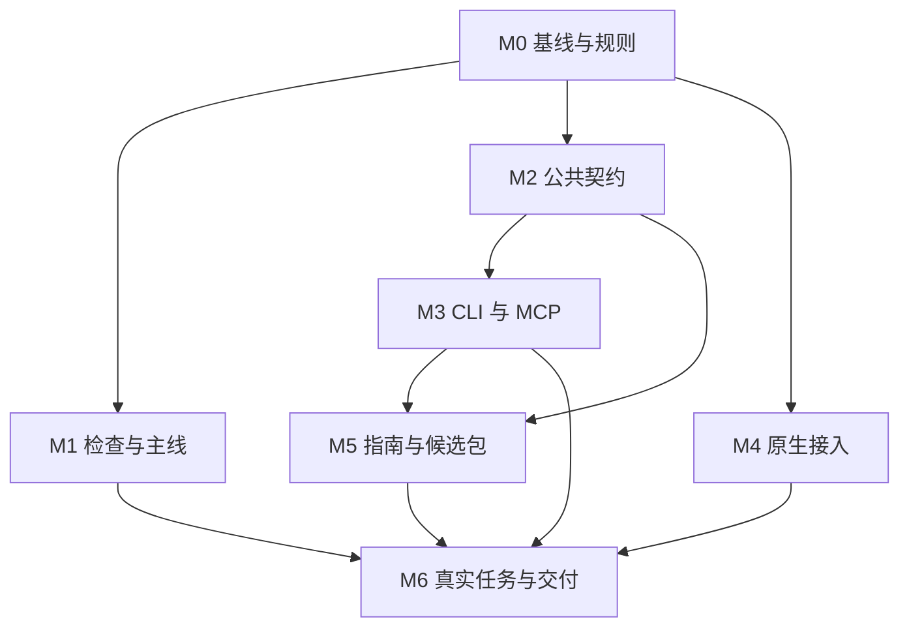

# SWA 仓库整合规划

**版本：2.2｜日期：2026-10-23（北京时间）**

**主仓：** songconmaisaix31-design/swarm-anything
**入仓位置：** docs/META_PLAN.md
**适用对象：** 产品负责人、开发主 Agent、模块 Worker、独立 Reviewer、研究 Agent

本规划定义仓库归属、文档职责、能力契约、整合工作包与交付标准。开发执行规则以 AGENTS.md 为准，本文只保留整合特有的内容；实现任务派生到现有 tasks/。

## 0. 执行总纲

当前按[产品清理与完整任务交付](../tasks/swa-evolution-20261023.md)推进：Astrocyte 与 Attention Mirror 分别抽为独立仓库，SWA 只保留工作区、角色/会话/任务/Worker、原生执行及必要显式集成。CLI 与 GUI 通过同一 Run 提交、观察、重连与导出；原 Task/Dispatch 维护递归交接和完整资源回收，能力按真实来源和执行结果展示。本轮同候选实际并发验收为 N=4、N=6。历史首版两 Worker、六卡 N=3 和旧 S3 保留各自证据，不代验新范围。

### 0.1 整合完成时的结果

用户在现有 Agent 中提交目标，由 SWA 的后台服务管理任务、协作、接续和成果；CLI、MCP 与可选网页访问同一份业务状态，用户可以查询阻塞、取得产物、了解实际消耗并完成既有的批准与采用流程。

本次整合完成时，应具备以下结果：

1. 默认开发入口指向当前产品代码，历史与研究原件可追溯。
2. CLI、MCP 和网页复用同一套任务、租约、预算、上下文与产物服务。
3. 能力目录、用户文档和发布 Skill 与实际发布接口一致。
4. 用户无需先整理注意力资料，即可进入已支持的项目任务流程。
5. 既定 S3 场景通过真实原生链路完成两 Agent 工作闭环。
6. 从安装后的发布候选中能够使用经过验收的路径。
7. 当前能力、待验证范围和扩展计划分别有明确位置。

### 0.2 固定的整合方向

- SWA 使用现有产品仓原地演进，保留 Git 历史与数据连续性。
- Astrocyte 的认知能力、Attention Mirror 的资料能力与 SWA 的执行能力分别拥有独立入口和构建闭包；SWA 的可选跨产品引用须显式配置。旧空间表的数据连续性及唯一 Workspace 写入责任保持。
- Morphogenesis 保留研究运行时、机制实验、评测与论文证据。有效机制按明确任务进入 SWA。
- 产品核心继续使用 Go、TypeScript 与 SQLite；外部工具依赖按已确认范围接入。
- 产品执行状态只由现有业务服务维护；新入口使用现有标识、授权、幂等和生命周期规则。
- 多机探测、远程孵化、跨节点接续、BCA、FCA 与复杂策略实验分别形成扩展任务。本次入口整合有独立的完成条件。

### 0.3 本规划的阅读方式

接管阅读按 AGENTS.md 第 2 节执行；随后读本文对应工作包与其引用的 SPEC 章节。本文记录的动作已经完成时，登记当前事实并接续其后工作。每轮读取范围由当前任务决定，长日志和历史报告按引用展开。

## 1. 已核实的起点（2026-10-20）

| 对象 | 已核实事实 | 整合处理 |
|---|---|---|
| 当前仓库 | swarm-anything，仓库 ID 1410836101；旧 Astrocyte 地址指向同一仓库 | 仓库改名已完成，本次处理代码、主线与文档 |
| 默认分支 | main，HEAD 3a02ce38481d1885adee2e051a1b524d78376897，仍为初始提交 | 默认入口纳入当前产品 |
| 当前产品分支 | songconmaisaix31-design/works-relay-integration，HEAD 32ab1eec808a5848aabad40f11133735a1214e55 | 从该产品历史接续整合 |
| 当前前端候选 | 与产品分支指向同一 HEAD | 已整合的前端直接复用 |
| 实际程序源码 | STATUS 指向 ed543c12106c2dbb3e181cb9bc1647b626455179；后继包含报告和治理文档 | 源码版本、文档版本和已构建产物分别记录 |
| 主控／实验记录 | validation/v1-20261012，HEAD c8df672770ddfd5e9f53ea64fdcd932d2e4bff76 | 含已确认决定、集成核查与研究记录，按内容保留 |
| Morphogenesis | codex/morphogenesis-mainline，HEAD ddd2849afe330bf221d405dc2b91948c2416bd47 | 已有本地 CLI、科研 MCP 和研究运行时 |
| REA 参考版本 | morluto/rea，main，HEAD 58d6043303e722115f1da18b9505c24abeeab423 | 仓库与开发模式参考固定到该提交 |

来源：[S00]、[S01]、[S04]、[S05]、[M01]、[R01]。

需继承的能力事实：

- 服务入口已经支持不配置网页目录，Swarm 生命周期与后台观察逻辑可独立启动。[S06]
- S3 组装已连接同一数据库、Workspace 批准、Registry、上下文输入、原件存储及原生发送授权。[S07]
- 当前 MCP 程序主要组装认知工具；通用任务入口仍需接入真实执行服务。[S08]

当前 TASKS 仍列有 Windows 契约检查进程崩溃；STATUS 仍将真实原生/S3、两 Agent 闭环及成果采用列为未验范围。这些事项进入本规划的工作包，完成状态由实际结果更新。[S01][S09]

## 2. 从 REA 采用的仓库与开发机制

开发规则据其文件与代码提炼。

| REA 已核实的做法 | SWA 采用方式 | 目的 |
|---|---|---|
| README 按定位、安装、Agent 使用、CLI、能力、案例和深入文档组织 | 首页按用户开始使用的顺序组织，详细算法与整合记录另有入口 | 降低第一次使用的理解成本 |
| CLI 与 MCP 共用应用服务，Provider 协议进入适配器 | 新入口调用现有 Go 服务，必要时提取仓内共同组装代码 | 同一动作具有一致的业务结果 |
| 工具按命名契约绑定，目录从实际注册与契约投影并检查差异 | 继承 OpenAPI 与现有服务，生成 SWA 能力清单并检查真实注册 | 减少接口、文档与代码漂移 |
| Provider 区分可发现、可用、支持目标和已选中 | Registry 展示安装、连接、会话、目标与执行能力事实 | 让调用方理解缺少的具体条件 |
| 输出保留摘要、证据引用、覆盖范围和未知项 | 外层 Agent 默认读取任务摘要，按需展开产物、检查与日志 | 减少重复输入完整执行轨迹 |
| 用户 Skill 有手写源，发布时注入对应版本元数据 | 面向用户的 SWA Skill 与开发规则分开，随已验版本打包 | 使用说明对应用户实际安装的能力 |
| 开发时选相关源码与边界检查，完整套件有明确执行位置 | 日常采用相关检查；CI 和发布候选承担完整确定性验证 | 缩短反馈时间，保留必要验证 |
| 验证安装后的实际包，发布已验证的同一归档 | Go 二进制、契约目录与配套 Skill 按一个候选版本验证与交付 | 开发结果能够被用户安装使用 |

依据：[R01]—[R10]。

### 2.1 适配时保留 SWA 的实际性质

- REA 的一次性 CLI 与部分 MCP 会话资源属于会话生命周期；SWA 的长任务继续由持久后台拥有，客户端断开后仍可查询。
- REA 的 TypeScript、Node、逆向引擎桥接和平台矩阵服务于其业务；SWA 沿用现有 Go/TS 项目组织。
- REA 从源码生成能力目录，同时保留手写的 CLI/MCP 适配代码；SWA 同样需要明确的协议实现和实际行为检查。
- REA 的贡献治理（首次人工 PR readiness 声明等）不引入；SWA 使用已确认的开发与授权流程，保留人工决定的真实身份，常规修复不新增重复确认。
- REA 的发布版本约定不照搬；SWA 单独说明 CLI、MCP、存储和 Skill 的版本兼容范围。

## 3. 仓库归属与复用边界

### 3.1 唯一产品主仓

swarm-anything 是产品开发、集成和发布的唯一主仓。Astrocyte 作为历史项目名称与可选注意力工作台概念保留。仓内既有模块继续拥有原来的业务对象。

| 模块或仓库 | 持续承担的职责 | 进入本次整合的内容 |
|---|---|---|
| Attention | 资料、沉淀、机会与品味反馈 | 保留现有能力，提供可选上下文来源 |
| Workspace | 项目、提案、批准、会话绑定、上下文包 | 作为项目任务执行的共同基础 |
| Swarm | Mission、WorkItem、Lease、Attempt、Artifact、Experience | 继续拥有任务执行与协作语义 |
| 原生 Agent 适配 | 真实运行时连接、能力证据、恢复、停止 | 修复实际接入问题，供所有入口共用 |
| CLI / MCP / HTTP / Web | 解析请求、显示结果、映射协议 | 共同访问相同业务服务 |
| Morphogenesis | 机制、研究运行时、基线、对照与论文 | 按任务迁移机制说明、必要实现与对应验证 |
| BCA / FCA 等 | 各自领域的能力 | 通过独立适配器连接，保留独立能力状态 |

### 3.2 复用的执行规则

1. 每项拟迁移资产记录原仓、原提交、原路径、目标职责、当前消费者与需要的验证。
2. 已经进入产品代码的实现原地保留，按当前文件核实其状态。
3. Morphogenesis 的迁移按完整机制进行：同时说明输入输出、作用边界和验证方法。
4. 代码、算法描述和实验结果分别保留来源。移入一种机制后，其效果仍由 SWA 对应条件下的验证决定。
5. 上游或协作者的代码保留原有许可证与归属说明；具体引入采用其许可允许的方式。
6. 历史基线、正式实验和论文原件保持可追溯。产品修复通过新提交推进。
7. 仓库名、Go 模块路径、用户命令、协议名称和数据目录作为独立变更处理，已有数据采用显式迁移或兼容读取。

### 3.3 现有决定的归一

依赖关系统一采用 SPEC：[S03]

- Domain：业务规则和值类型。
- App：业务流程，声明所需端口并调用 Domain。
- Adapters：实现端口，处理数据库、原生运行时及协议。
- Composition：创建具体实现并注入依赖。
- CLI/MCP/HTTP：完成协议边界处理，复用 App 业务语义。

Python 采用已确认决定：底座保持 Go/TS/SQLite，summarize 等工具可使用其所需依赖；Morphogenesis Python 研究运行环境独立保留。[S04]

AGENTS.md 与上述两条不一致的位置，按 7.5 的 M0 清单修订。

## 4. 目标仓库格式与文档职责

采用 REA 的文档分工，保留现有 Go 目录。已存在的同类文档更新原文并建立链接；新增页面在有实际内容时创建。阅读入口见 AGENTS.md 第 2 节；本表定义各文档的唯一职责与维护规则。

### 4.1 根目录与开发文档

| 位置 | 唯一职责 | 维护方式 |
|---|---|---|
| README.md | 产品定位、开始使用、能力表、案例与指南入口 | 面向用户；能力说明跟随发布范围 |
| CONTRIBUTING.md | 环境准备、任务提交、检查、PR 与发布协作 | 记录可执行命令与贡献流程 |
| STATUS.md | 当前产品版本、已验结果、阻塞与下一项任务 | 当前状态唯一入口 |
| HANDOFF.md | 接管所需上下文、当前执行者与下一动作 | 指向原始记录，避免复制完整状态 |
| docs/META_PLAN.md | 本次整合方向、文档归属、工作包与完成条件 | 稳定规划；范围变化时更新 |
| docs/SPEC.md | 产品行为、领域关系、权限与契约原则 | 业务与架构规范的事实源 |
| docs/TASKS.md | 当前排序、依赖和任务链接 | 每项仅保留调度所需摘要 |
| tasks/<task-id>.md | 某项任务的目标、范围、实施与验证结果 | 一项任务一份连续记录 |
| docs/QUESTIONS.md | 已确认决定、适用范围与真实待决项 | 保留原始决定，标明被后继决定替代的关系 |
| docs/RESOURCES.md | 已确认的环境、预算与并发参数 | 其他文档引用，避免重复数字 |
| docs/CODING.md | 命名、错误处理与代码习惯 | 引用 SPEC 的依赖规则 |
| docs/architecture.mermaid | 当前入口、服务、适配器与存储关系 | 随相关架构变化更新 |

### 4.2 用户指南与发布说明

| 位置 | 内容 |
|---|---|
| docs/installation.md | 支持环境、安装、连接已有 Agent、项目配置、更新与移除 |
| docs/cli.md | 公共命令、输出、退出行为和任务接续 |
| docs/mcp-contracts.md | 工具、输入输出、错误、认证主体与长任务语义 |
| docs/testing.md | 变更类别、适用检查、真实运行时验证与证据范围 |
| docs/releasing.md | 候选版本、兼容说明、包验证、发布与安装后检查 |
| 既有研究目录与 Morphogenesis 文档 | 方法、基线、实验、论文和原始报告 |

README 推荐顺序：用户能完成的目标 → 快速开始 → 在 Agent 内调用 → CLI 调用 → 支持能力与前置条件 → 已验案例 → 常见问题 → 开发与研究入口。

### 4.3 代码与生成物

| 位置 | 处理方向 |
|---|---|
| cmd/server/ | 复用现有持久后台与生命周期组装 |
| cmd/mcp/ | 扩展任务工具，接入共同执行服务 |
| cmd/swa/（新增） | 提供面向用户的 CLI；必要时统一 serve/mcp 子入口 |
| internal/attention/、workspace/、swarm/ | 保留既有业务归属 |
| internal/adapters/ | 继续承接协议、存储和运行时 |
| contracts/openapi.yaml | HTTP 公共消息与 Schema 来源 |
| scripts/generate-client.mjs | 继续生成现有 TypeScript API 类型 |
| web/src/api/schema.d.ts | 生成文件，通过现有生成命令更新 |
| .agents/skills/swarm-anything/（新增） | 面向使用者 Agent 的手写 Skill 与按需参考页 |
| 发布包中的 Skill、能力目录 | 从对应源码版本生成并打包 |
| 临时运行目录 | 保存可重建日志、缓存和中间结果，按现有仓库规则排除提交 |

既有生成文件沿用其跟踪策略；新增发布生成物明确来源与生成命令。构建、测试准备、文档生成和真实模型验证分别安排。发布用的版本信息只描述该候选包实际包含的能力。

## 5. 公共能力契约与生成关系

### 5.1 继承当前契约链

当前源文件是 contracts/openapi.yaml。根 pnpm generate 调用 scripts/generate-client.mjs，使用 openapi-typescript 生成 web/src/api/schema.d.ts。

当前 pnpm check:contracts 依次执行：

1. 使用 contracts/redocly.yaml 校验 OpenAPI；
2. 使用 scripts/validate-examples.mjs 校验规范中的示例与能力边界；
3. 使用 generate-client.mjs --check 比较重新生成的类型与已提交文件。

这个生成链目前不生成 Go DTO。Go 消息结构与适配逻辑仍由现有手写代码提供，其行为通过实际接口检查与 OpenAPI 对应。[S10][S11]

公共能力归属：

| 内容 | 来源与负责位置 |
|---|---|
| 任务状态及其转换、授权和租约规则 | 现有 Domain/App |
| HTTP 公共字段、Schema、错误与示例 | contracts/openapi.yaml |
| Go 公开 DTO 与业务对象转换 | 现有 HTTP／服务适配边界 |
| TypeScript API 类型 | 由现有脚本生成 |
| MCP 工具名称、专属调用说明与注册 | MCP 适配器；公共输入输出引用对应契约 |
| CLI 命令注册与参数映射 | CLI 适配器；公共结果引用对应契约 |
| 用户可见能力目录 | 从已定义契约和实际 CLI/MCP 注册投影，并检查对应关系 |
| 部署后的可用能力 | 运行服务与 Registry 的实际观察，附环境、版本和缺失条件 |

新增公共能力在同一任务中更新受影响的服务、必要的 Go DTO、公共契约、CLI/MCP 绑定、生成物与真实接口检查。共享的公共字段继续复用现有 OpenAPI；协议独有能力按其实际边界处理。目录生成只承担投影和差异检查，协议适配代码由对应入口负责。

MCP 使用的 JSON Schema 在 SDK 转换后检查实际对外形式与客户端可接受范围。工具按明确名称绑定，生成目录的排列顺序不参与选择处理函数。

### 5.2 外部工具围绕目标组织

以下名称是整合目标，实施时由 M2 固定最终映射：

| 用户意图 | 建议 CLI | 建议 MCP 工具 | 共同业务职责 |
|---|---|---|---|
| 了解可用能力 | swa capabilities | swa.capabilities | 查询后端与运行时能力 |
| 提交目标 | swa task submit | swa.submit | 校验主体、项目、已批准范围和幂等请求，建立任务 |
| 查看进度与阻塞 | swa task status | swa.status | 读取同一任务状态及下一步需要的信息 |
| 获取成果 | swa task result | swa.result | 返回产物、验收、摘要和完整记录引用 |
| 请求停止 | swa task cancel | swa.cancel | 记录停止请求并查询实际执行结果 |

任务认领、续租、提交、移交等工具服务于内部 Worker。资源查询、受控扩容等工具属于相应的运维能力。新工具提案先说明用户问题、现有接口的表达缺口和新增结果，避免按内部函数数量增加公开工具。

外层 Agent 负责表达目标、准备已授权环境、转达状态和结果。内部任务协作由 SWA 业务服务与执行成员完成。开发阶段的主 Agent 管理待办与集成；这个开发角色不决定产品内每个 Worker 的任务选择。

用户本人作出的批准与采用，继续通过既有可信用户入口取得。MCP／CLI 中的主体字段不构成用户确认的证据。

### 5.3 安装、连接与能力分开表示

能力信息分别展示：

- 是否发现目标运行时，以及所观察的路径与版本；
- 是否完成当前连接；
- 是否能创建或绑定会话；
- 是否支持本次项目、执行范围、停止及接续方式；
- 本次能力判断的来源与未覆盖部分；
- 任务当前采用的具体运行时和绑定身份。

"已安装""已连接""该目标可执行"各自保留事实。原生能力准入口径沿用已有决定；M2 为未知信息提供稳定表达，不代答当前仍未确认的选择。

### 5.4 精简输出与可取回原件

公共结果复用现有任务、操作、尝试、产物和版本标识。默认输出包含状态、可读摘要、验收结论、阻塞原因、已知消耗及必要引用。详细 diff、日志、上下文与检查结果按需展开，长列表采用明确的分页或游标。

保持原义的信息：

- 费用未知仍为未知；
- 检查未执行仍保留未验状态；
- 成果提交、检查通过和用户采用分别记录；
- 缺少能力证据返回具体缺失条件；
- 一次客户端超时不自动证明任务或提供方调用已经结束。

能力目录描述软件支持什么；Registry 描述当前环境能使用什么；一次任务记录描述实际发生了什么。界面与文档分别读取这三类来源。

## 6. 生命周期、安装与用户 Skill

### 6.1 同一个后台拥有长任务

CLI/MCP 可以退出或断开，任务仍由现有后台与数据库持久管理。新连接使用已有任务编号继续查询。

业务幂等键由调用方稳定传递。已确认可重试的失败，按当前规则建立有来源关系的新尝试。效果未知时继续查询和核实，保持原请求身份；明确允许另起作业的既有决定按其范围执行。重试规则沿用当前授权和预算约束。

取消请求、执行停止、租约变化和资源释放分别由对应服务记录。进程或远端调用尚未确认结束时，保留相应的资源占用与未知信息。任务交接通过当前租约和提交权机制确认执行所有者。

支持 MCP Tasks 扩展的客户端协商对应的长任务句柄；普通客户端继续使用提交、查询与取结果接口。协议状态转换映射到真实业务状态，传输层确认不用于宣告执行停止。[P01]

### 6.2 安装管理明确选择的范围

统一提供安装与诊断体验，复用已经安装、配置并可使用的运行时。

- 安装说明清楚区分 SWA 程序、MCP 注册、用户 Skill 和执行运行时。
- 配置写入说明目标客户端、文件、作用域和备份位置；按已有授权应用。
- 重复安装或连接不产生重复注册。
- 更新使用清楚的版本与兼容检查；移除只处理 SWA 拥有的配置项。
- 已连接且能力满足当前任务时直接工作；观察到连接或能力故障时再执行相关诊断。
- 一个可选适配器缺失时，其他已可用能力继续显示。当前任务明确需要的能力失败时，保留其真实原因。

用户执行任务时只需要理解目标、范围、结果和需要处理的事项。安装内部步骤、进程实现和存储细节进入诊断结果与开发文档。

### 6.3 用户 Skill 与开发规则分开

面向使用者的 Skill 包含：

1. 判断已有 SWA 连接和可用能力；
2. 将用户目标转换成任务请求；
3. 查询进度，转达真实阻塞；
4. 获取足够回答问题的结果；
5. 在需要时展开产物、接续和诊断参考页；
6. 将需要用户处理的事项交回真实用户渠道。

用户 Skill 按需链接连接恢复、任务接续、结果审阅等参考页。包内文档对应已发布的服务及契约版本。手写源由作者维护，发布元数据由构建过程生成。[R07][R08]

开发 AGENTS 负责代码规则、任务流程和验证，用户 Skill 负责使用产品。二者通过公共契约连接。

## 7. 整合期间的开发与决策

### 7.1 任务以可观察结果为单位

每个任务覆盖一个完整用户结果或直接支撑该结果的独立修复。服务、受影响的入口、相关验证和必要文档由同一任务统筹。

典型任务写法：

> 让用户在 MCP 提交任务后，通过 CLI 查询到同一个任务、当前阻塞和产物；客户端重连与重复请求保持现有任务身份。

对应任务明确服务、契约和入口的负责人。跨模块变化先固定本次所需边界，再按互斥写域安排实现。接口发生必要调整时，在原任务中更新影响范围并通知消费者。

### 7.2 任务内的开发循环

任务计划列出可观察结果、关键失败路径、契约变化和受影响消费者。测试计划的编写、审核、实现与返修按 AGENTS.md 执行。

1. **定位业务负责人。** 确认哪一层拥有该状态或解释，查找最接近的现有能力。
2. **完成实现与相关修复。** 在产生问题的边界修正表示、所有权或业务规则，同步必要消费者。
3. **执行对应检查。** 开发中取得相关快速反馈，集成时完成适用边界验证（第 8.1 节）。
4. **集成并更新事实入口。** 按已有合入规则进入唯一产品主线，更新任务记录与 STATUS。
5. **按发布范围验证。** 影响安装或分发的任务继续验证候选包和使用说明。

增补同一范围的场景在原记录中更新；实质改变行为或授权范围时再处理相应决定。

### 7.3 并行与共享资源

- 共享契约、同一内部表示、同一生成物或同一运行资源由一个负责人安排修改顺序；独立读取与互斥代码实现并行。
- 共用生成物由明确的任务生成；真实 Agent、数据库和进程使用可识别的隔离实例。
- 使用现有协调机制安排冲突，不增加新的开发调度服务。

### 7.4 决策分级

- 普通命名、局部组织和已批准行为内的实现细节由任务负责人决定并说明。
- 影响验收、权限、调用预算、数据外发或不可逆结果的未决项明确引用既有记录，等待用户决定。
- 论文、安装包、普通产品代码和对外发布分别使用自己的完成与授权条件。

### 7.5 对 AGENTS.md 的修订清单（M0 执行）

| 当前问题 | 目标规则 |
|---|---|
| 分层方向与 SPEC 冲突（AGENTS 写有领域层调用数据层，SPEC 要求 Domain 不依赖数据库和适配器） | 统一采用 3.3 的依赖关系，AGENTS 引用该章节及检查入口 |
| Python 绝对禁令与现行决定不一致 | 将 3.3 的 Python 决定同步到对应规范位置 |
| 固定的文件重叠百分比 | 由实际写域和依赖判断替代 |
| 一切模糊点都升级用户 | 只升级影响当前目标、权限或验收的真实决定 |
| 每项变更都复制全部测试层 | 依照变更边界选择验证，保留已确认任务的必要检查 |
| 模块长期负责容易形成长期分叉 | 责任长期保留，任务分支按交付结束 |
| 多处保存相同进度、参数和决定 | STATUS、RESOURCES、QUESTIONS 各自拥有事实 |
| 实现层层补丁而解释重复 | 在负责该解释的边界修正，更新直接消费者 |
| 规则包含临时状态与一次性条件 | 移入对应任务与决定记录，AGENTS 保留稳定指引 |

整理保留现有的真实链路要求、资料与执行范围、来源记录和用户明确偏好。

## 8. 验证与提效标准

### 8.1 按变化选择验证

| 变更类型 | 日常反馈 | 集成／发布需要的对应证据 |
|---|---|---|
| 普通文档、导航、文案 | 来源、链接、示例与生成物检查 | 文档与当前实际能力一致 |
| 公共 Schema、DTO、注册 | 契约检查、生成差异、相关适配器检查 | 实际 HTTP/CLI/MCP 请求与响应符合契约 |
| 任务、租约、幂等、预算 | 相关 Go 包、真实存储和关键并发场景 | 重复请求、冲突、交接和未知状态保持正确语义 |
| 原生 Agent 接入 | 真实环境能力探测与对应局部路径 | 指定运行时、范围、会话和实际任务结果 |
| 安装、更新、分发 | 包内容与配置变更检查 | 在独立安装位置运行候选包的 CLI/MCP |
| 性能或协作策略 | 等价任务的相关测量 | 验收结果、资源、耗时和未测范围可比较 |
| 研究方法或论文 | 方法、来源、实验版本一致性 | 按该研究的对照与重复条件判断结论 |

确定性规则使用公开、可检查的小型输入。真实运行时验收使用目标运行时，真实任务验收保留实际成果；不同检查各自说明支持的结论。

### 8.2 开发反馈、完整检查与真实运行分开安排

- 日常运行本次变化涉及的测试、静态检查和明确的边界检查。
- 动态注册、脚本、生成物和跨协议行为采用显式检查，补足单纯导入图选测的缺口。
- CI 承担已配置的完整确定性套件；受当前环境限制的检查给出具体状态。
- 真实原生 Agent、提供方调用和资源敏感实验根据实际版本、任务及额度运行。
- 安装后的程序单独验证。源码目录内运行成功只记录其实际覆盖范围。
- 文档后继若未改变程序与包输入，复用同源程序的有效结果，并明确源码与文档版本关系。

有缓存的检查记录键包含会影响结果的源文件、依赖、工具版本、平台和参数。真实在线状态重新观察；真实模型结果不通过缓存重新描述为一次新运行。

### 8.3 保留有意义的失败路径

优先覆盖会改变用户结果的情况：重复提交、版本冲突、取消期间完成、停止未确认、过期租约、交接后旧实例提交、部分产物、能力缺失、配置重复写入和资源释放失败。

每个检查说明它验证的需求或故障。相同语义已有更强验证时，合并重复用例；保留独特的错误、身份、权限和资源行为。已明确选择的检查有实际结果，缺少用例或零执行需要被识别。

### 8.4 按完整任务衡量效率

产品级观察包括：

- 可采用成果及验收通过情况；
- 用户需要介入的次数与返工；
- 从提交到可采用成果的时间；
- 已知模型调用、输入输出用量及费用；
- 上下文读取量、工具回合与结果重复传输；
- CPU、内存及并发资源消耗。

改动前后保持目标、验收条件和可比资源范围。区分冷启动与复用结果；估算项和未测项明确保留。减少 JSON 字节只支持输出体积变化，实例数量变化只支持规模变化；任务提效由完整任务结果判断。[R02][R09]

现有 MorphBench 报告明确尚未证明算法优势，报告中的合计结果不作为 SWA 单独成绩。入口整合验收和协作收益实验各有自己的完成条件。[M03]

## 9. 整合工作包与依赖

工作包用于派生现有 tasks/ 中的实际任务。已有任务覆盖相同目标时补充它的范围与验收，保留原任务编号和连续记录。每个工作包由一名负责人完成集成，内部按实际边界分工。

### 9.1 工作包清单

| 编号 | 目标与主要范围 | 前置条件 | 完成证据 |
|---|---|---|---|
| M0 基线与规则整理 | 核对已改名仓库、产品 HEAD、集成核查、任务与决定；按 7.5 清单修订 AGENTS 并归一文档职责；明确将进入 main 的内容 | 当前远端事实与既有记录 | 一份有来源的整合清单；现行规则一致；每项待办有唯一记录；已完成改名从待办移除 |
| M1 恢复确定性检查并收拢主线 | 解决既有 Windows 契约命令崩溃；处理产品分支与主控分支中的实际内容差异；将已验证产品历史纳入默认 main | M0；现有任务要求的测试计划审阅 | 原始 pnpm check:contracts 完整执行成功；对应集成检查通过；main 包含产品代码、有效决定和当前状态，历史连续 |
| M2 公共契约与能力目录 | 对应现有服务定义目标级 CLI/MCP；复用 OpenAPI；建立注册与目录一致性检查；明确能力状态和错误表达 | M0；目标与业务语义已明确 | 服务到工具映射、实际注册目录与公共 Schema 一致；未知能力可准确表达；无重复任务账本 |
| M3 CLI/MCP 任务入口 | 通过现有后台完成提交、查询、取成果、停止；处理身份、幂等、版本、断开与重连 | M2 的对应接口 | CLI 与真实 MCP 客户端可交叉查询同一任务；重复请求与断开不会额外建立任务；结果能取回完整原件 |
| M4 原生 S3 接入与接续 | 修复 Registry、绑定、原生发送、恢复、显式交接、租约与提交路径；保持既有工具权限和预算语义 | M0；具体路径需要的既有决定 | 指定原生运行时的能力有实际证据；接续与交接路径可执行；旧所有者提交、未知停止等关键情况有结果 |
| M5 使用入口、安装与发布候选 | 按真实接口更新 README、指南和用户 Skill；提供 CLI/MCP 安装配置；调整可选网页的任务与结果视图；构建候选包 | M2 后可写指南；可执行安装验证依赖 M3 | 文档与目录同版；配置重复执行可复用；独立安装位置可运行候选；网页按共同状态展示结果和待处理事项 |
| M6 完整任务与交付验收 | 使用候选包完成既定真实 S3 场景；验证两个 Agent、接续、交接、检查、成果及用户采用；整理可交付版本 | M1、M3、M4、M5 | 第 12 节适用项目实际通过；S3 有实际任务与产物；交付文件就是已验证文件；未通过项继续作为 M6 的剩余任务 |

M1 中的普通主线集成与 Windows 检查修复分别推进，沿用已确认的"产品集成优先"决定和现行仓库流程。完整默认检查、L1/L2 及独立报告的缺项继续记录，不新增为普通集成与启动的前置条件；最终交付按适用验收判断。[S04]

M2、M4 在 M1 修复期间继续进行独立工作。实际合入条件短时阻塞时，其他任务仍基于同一产品历史推进；恢复后及时回到 main。README 的定位与导航提前整理，能力承诺以最终验证结果为准。

### 9.2 依赖关系



并行前明确写入范围、公共契约和共享资源。

### 9.3 S3 的具体阻塞按路径处理

现有决定记录中，原生路径仍涉及以下待决范围，实施时核对是否已有后继决定：[S04]

| 待决范围 | 必须说明的差异 | 实际影响 |
|---|---|---|
| 调用预算口径 | 按平台提交的模型输入计数，或按模型服务内部全部尝试计数、证据不全时阻止执行 | 调用授权、消耗记录和实验可比性；失败与交付未知的既有占用规则保持 |
| 原生能力验证范围 | 逐项核实本次批准所需的工具关闭与外发限制，或要求完整工具及外发目标清单 | 绑定与 Claim 的准入条件；完整清单未取得时继续明确未知 |
| 原生工具权限验证 | 保持文件与命令工具关闭要求并继续暂停相关执行，或先实际验证只读 sandbox 拒绝写入、保留命令工具关闭，再执行既定公开任务 | 原生执行配置与对应任务验收；改变方案需要对应原问题的有效决定 |

工作负责人引用原问题与已有选项，说明当前哪条路径依赖该决定。普通查询、契约生成、配置整理及不触及该语义的实现继续推进。能力未知按当前规则处理，预算与工具范围遵循已生效决定。

M4 接入完成后，M6 使用既定 S3 任务与验收记录，形成可追溯的过程：实际项目和批准 → 原生会话绑定 → Worker 认领 → 实际执行、原生接续及显式交接 → 提交产物 → 固定检查 → 既有用户采用流程。两个 Agent 的角色、任务身份、提交权和成果来源都能解释。

远程孵化、跨机器环境迁移、链上身份、BCA/FCA 联动和大规模策略实验各有独立任务。这些扩展的状态保留在能力计划中，不占用本次 S3 的完成定义。

## 10. 默认主线与既有分支的整合方式

### 10.1 主线收拢的顺序

1. 以当前仓库地址重新读取默认分支、产品分支、主控分支与前端候选的 HEAD。保存本次比较的确切版本。
2. 继承已有 integration-audit-20261020.md，补充审计后发生的变化。对相同版本和问题复用已完成核查。
3. 以产品分支的实际代码作为整合起点；核对 main 的祖先关系以及主控分支里的唯一内容。
4. 按已确认的普通集成条件解决内容冲突，将当前产品历史纳入默认 main。可快进时采用快进；存在真实分叉时按内容合并，并保留来源。检查失败在原任务中继续修复并如实记录。
5. 将 main 作为后续开发、CI、发布和新 Agent 阅读的共同入口。STATUS 同时保留仍未通过的真实 S3 项。
6. 更新仓库入口、任务链接和贡献说明；分支归档按实际内容归属处理。

当前 main 仍是初始提交。源码收拢与真实 S3 验收分别记录进度，避免默认入口长期落后于可继续开发的产品。[S01][S05][S15]

### 10.2 每条分支只做一次有依据的处置

| 内容状态 | 处理方式 |
|---|---|
| 已存在于产品历史 | 标明对应提交或等价内容，结束重复维护 |
| 唯一且仍有效的产品实现 | 整项理解行为及依赖，按任务移入并验证 |
| 已确认决定、资源事实或集成报告 | 纳入其所属文档；冲突按决定时间与适用范围解释 |
| 研究运行时、原始实验、论文证据 | 保留研究来源，产品文档引用原件 |
| 已被后继方案替代 | 保留替代关系与原历史，关闭原待办 |
| 尚有独立有效工作 | 指定负责人、剩余结果与短期集成目标 |
| 本地未提交或仅在工作树中的工作 | 在相关本地环境核对后再安排保留或集成 |

提交数量、分支名称和 ahead/behind 数字辅助定位历史；内容是否有效由实现、任务和验证结果判断。某次合并实际带入的内容逐项核查，祖先关系不作为依据。

归档或删除分支前，确认其唯一内容、原始记录及本地工作已被保留。

### 10.3 后续分支规则

- 产品长期维护 main；任务分支由具体交付建立，完成集成后结束。
- 模块负责人长期负责模块，代码随任务持续进入同一产品主线。
- 前端、后端、MCP 和研究协作按任务范围安排；研究原件留在其所属仓库或研究目录。
- 修改共享契约或生成物时由相应负责人协调。
- 提交说明解释用户问题、变化和验证；任务文件保留当前状态，避免分支日志成为另一个进度来源。

## 11. 发布候选、兼容与包验证

### 11.1 版本对应关系

每个候选明确程序源码提交、文档与目录版本、构建环境、支持平台、包摘要及用户 Skill 版本。程序之后只有文档修订时，明确对应关系，使用仍有效的程序验证结果。

SWA 维护自己的兼容说明，分别覆盖 CLI 参数与输出、MCP 工具与 Schema、HTTP 接口、任务状态、存储格式及配置。实现先沿用现有版本机制；M5 补齐对外承诺和不兼容变更的迁移方法。

仓库已经改名。Go module、包名、启动命令、客户端配置、数据目录和协议标识逐项检查消费者及兼容影响。链接更新与持久数据迁移各自验证。已有 SQLite 数据及原件继续有可识别的来源，迁移在副本上验证后按现行流程应用。

### 11.2 测试过的包就是交付的包

借鉴 REA 的安装验证与发布流程。[R10][R11]

M5 提前完成打包与安装流程。供 M6 使用的最终候选包含 M1、M3、M4 已集成的程序版本，并以该候选及其明确对应的后台版本完成安装后的 S3 验收。复用已有后台时，记录并核对后台版本。

1. 从确切源码构建一个候选包，生成与其一致的能力目录和 Skill。
2. 在独立安装位置安装该候选，使用正常用户入口调用程序。
3. 验证 CLI 帮助与配置、真实 MCP 握手与工具注册、后台连接及规定的任务流程。
4. 对安装或更新变化，验证重复配置、版本不匹配、现有数据识别与移除范围。
5. 根据实际通过的平台和能力形成发布说明；完整保留失败与未验范围。
6. 对外交付或发布该已验证文件；发布后检查用户实际消费路径。发生重建或重新打包时，按变化重新验证新文件。

MCP 长任务扩展按客户端实际协商使用；通用的提交与查询流程始终有明确支持范围。安装成功、进程可启动、MCP 已连接和任务通过各自具有验收结果。

支持矩阵来自实际验证。优先覆盖现有目标环境，Windows 契约检查及原生运行环境限制继续列明；尚未测试的平台不写为已支持。版本发布使用已有授权流程。

### 11.3 用户界面和成绩展示

网页保留任务进度、需要用户处理的决定、成果审阅、比较与采用等价值。用户也可从 CLI/MCP 完成已支持的流程。

成绩展示绑定明确任务与验收条件，优先显示检查结论、可采用产物、耗时、已知消耗和人工介入。汇总分数说明组成项和缺失数据；算法效果由对应实验支持。未知消耗、未执行检查与未完成采用在所有入口保持相同表达。

## 12. 整体完成条件

下表作为 M6 的验收索引。具体命令、输入、环境与结果写入对应 tasks/ 文件，STATUS 只维护总状态和链接。现有验收要求继续有效；表内的场景补足整合涉及的边界。

| 编号 | 用户或维护者可观察的结果 | 需要保留的证据 |
|---|---|---|
| A01 唯一主线 | 新贡献者从默认 main 得到当前产品和有效开发入口 | 比较版本、整合提交、当前状态与任务链接 |
| A02 数据与服务复用 | 原项目、会话、任务、批准和产物在新入口可识别，业务状态具有同一来源 | 现有数据的读取／迁移结果，同一对象的跨入口查询 |
| A03 契约一致 | 注册的 CLI/MCP 能力、公共消息、目录和发布说明对应 | 原始契约命令结果、注册检查、真实接口响应、生成差异 |
| A04 目标可执行 | 用户从现有 Agent 或 CLI 提交范围明确的目标，后台建立并推进任务 | 真实客户端请求、主体与范围、任务编号、状态过程 |
| A05 重复与断开可解释 | 重复提交可识别；客户端断开后仍能查询原任务和结果 | 同一幂等请求、重连查询与相关执行次数 |
| A06 S3 真实闭环 | 既定任务由真实原生运行时和两个 Agent 完成，原生接续、显式交接及提交权分别成立 | 绑定、能力、认领、租约、实际任务产物、固定检查，以及由既有可信用户入口产生、可回查用户主体和来源的采用记录 |
| A07 授权保持一致 | 各入口使用现有主体和批准；任务结果能区分提交、检查和用户采用 | 允许与拒绝的相关路径、批准来源、真实采用主体和操作记录 |
| A08 生命周期与预算准确 | 停止请求、实际停止、配额释放和调用消耗各自可查；未知信息保持明确 | 取消期间完成、停止未确认或资源释放失败等相关案例；预算与用量来源 |
| A09 安装后可用 | 用户安装候选包后完成声明支持的 CLI/MCP 路径 | 实际归档身份、安装位置、客户端与版本、包内指南及任务结果 |
| A10 可选界面可审阅 | 任务支持直接开始；网页与命令入口展示同一结果及待处理事项 | 对应入口的实际操作、产物引用及分数／消耗来源 |

A06 依赖既有 S3 决定和真实运行时条件；尚未具备时记录具体缺失项。本次整合全部完成的宣称，以本表适用项目和现有任务验收实际通过为条件。

功能整合完成后，单独评估 SWA 的协作收益。该评估使用相同目标、验收规则、可比模型与预算，并报告失败、重试、人工介入及未测项。协作机制获得更强产品地位的依据来自其结果。

## 13. 派生任务与开发 Agent 接管模板

### 13.1 任务记录模板

任务保持一页主记录，详细报告通过链接展开，字段按实际任务删减。

```markdown
# <任务编号> <可观察的用户结果>

## 目标与完成条件
用户要完成什么；哪项结果可以判断完成；对应 M / A 编号。

## 当前事实与依赖
规范仓库、程序提交、当前任务状态。
引用有效 SPEC、QUESTIONS、RESOURCES；说明真正依赖的未决项。

## 复用与改动范围
现有服务／原仓提交／原路径；业务语义负责人。
拟修改的文件范围、公共契约变化、生成物及消费者。
与其他执行者共享的文件或资源及协调方式。

## 实施与验证
需要完成的行为；有意义的失败路径。
对应检查、真实运行条件及现有有效证据。
已确认任务要求的审阅与执行顺序。

## 当前结果与接续
实际完成项、源码／包／产物、验证结果。
具体剩余问题及其影响；下一项动作与负责人。
```

### 13.2 给开发主 Agent 的接管指令

> 按 AGENTS.md 完成接管阅读后，读取本文相关工作包及直接引用的规范，选择当前最早可执行且尚未完成的用户结果。先确认业务语义和复用位置，在现有任务记录中补齐完成条件、写入范围及必要验证。任务结束时记录结果、版本、产物、验证和剩余问题，按当前流程集成到 main，更新唯一状态入口。

### 13.3 本规划的维护条件

产品范围、仓库归属、事实来源或交付定义发生变化时修订本文。普通任务进展只更新任务文件和 STATUS。新研究结论进入相应实验与决定记录；被产品采用的机制再派生开发任务。

## 14. 来源与核查范围

核查时间 2026-10-20；代码、规范、仓库元数据和 MCP 官方说明固定到当日读取的提交。接管时以最新远端状态核对变化。

### 14.1 SWA 与既有产品资产

| 编号 | 资料及用途 |
|---|---|
| [S00] | GitHub 仓库元数据：当前规范名称、仓库身份与默认分支 |
| [S01] | STATUS：产品源码、验证结果及真实 S3 未验范围 |
| [S02] | AGENTS：现有开发规则与需要归一的架构描述 |
| [S03] | SPEC：产品行为、Domain/App/Adapters 与权限原则 |
| [S04] | QUESTIONS：主控分支的已确认决定、Python 范围及原生 S3 待决项 |
| [S05] | 既有集成核查：主线、前端、研究与独立内容的归属 |
| [S06] | server/main.go：后台启动及网页目录可选行为 |
| [S07] | relay_swarm_assembly.go：S3 共用业务服务与资源的组装 |
| [S08] | mcp/main.go：当前 MCP 入口和认知工具组装 |
| [S09] | TASKS：现有任务、Windows 契约检查阻塞与实施要求 |
| [S10] | package.json：现有生成、契约检查和开发命令 |
| [S11] | generate-client.mjs：OpenAPI 到 TypeScript 生成及逐字漂移检查 |
| [S12] | validate-examples.mjs：公共示例与错误行为的 Schema 检查 |
| [S13] | openapi.yaml：现有 HTTP 公共契约 |
| [S14] | swarm_missions.go：Go HTTP 消息、版本与幂等处理 |
| [S15] | 默认 main 与当前产品提交的历史比较 |

### 14.2 Morphogenesis

| 编号 | 资料及用途 |
|---|---|
| [M01] | README：研究运行时、CLI 和科研 MCP 的现有定位 |
| [M02] | research/server.py：科研 MCP 实际注册来源 |
| [M03] | MorphBench 正式报告：实验范围与算法优势的证据限制 |

### 14.3 REA 参考

所有 REA 源码引用固定到 main 的 58d6043303e722115f1da18b9505c24abeeab423。

| 编号 | 资料及用途 |
|---|---|
| [R01] | README：用户路径、能力说明和文档入口 |
| [R02] | AGENTS：开发纪律、语义归属、验证和度量原则 |
| [R03] | CONTRIBUTING：开发反馈、生成物、贡献和审阅方式 |
| [R04] | architecture.mermaid：应用层、协议入口、Provider 与组装关系 |
| [R05] | tool-design：目标级工具、契约、结果与生命周期设计 |
| [R06] | product-catalog.mjs：从实际注册与契约投影能力目录 |
| [R07] | 用户 SKILL.md：按需使用、连接恢复与事实判断 |
| [R08] | generate-skill-metadata.mjs：发布 Skill 的生成与版本绑定 |
| [R09] | testing：相关测试、完整检查、实际 provider 和质量评估的分工 |
| [R10] | releasing：准确源码、归档身份与发布消费路径 |
| [R11] | verify-package.mjs：安装后实际 CLI/MCP 包验证 |
| [R12] | toolContractTypes.ts：工具契约的源码类型 |
| [R13] | goCommands.ts：CLI 调用公共应用服务的实际实现 |
| [R14] | registerGoTools.ts：MCP 调用同一应用服务的实际实现 |

### 14.4 协议参考

| 编号 | 资料及用途 |
|---|---|
| [P01] | MCP Tasks 官方说明：能力协商、长任务句柄与相关状态语义 |

[S00]: https://api.github.com/repos/songconmaisaix31-design/swarm-anything
[S01]: https://github.com/songconmaisaix31-design/swarm-anything/blob/32ab1eec808a5848aabad40f11133735a1214e55/STATUS.md
[S02]: https://github.com/songconmaisaix31-design/swarm-anything/blob/32ab1eec808a5848aabad40f11133735a1214e55/AGENTS.md
[S03]: https://github.com/songconmaisaix31-design/swarm-anything/blob/32ab1eec808a5848aabad40f11133735a1214e55/docs/SPEC.md
[S04]: https://github.com/songconmaisaix31-design/swarm-anything/blob/c8df672770ddfd5e9f53ea64fdcd932d2e4bff76/docs/QUESTIONS.md
[S05]: https://github.com/songconmaisaix31-design/swarm-anything/blob/c8df672770ddfd5e9f53ea64fdcd932d2e4bff76/docs/integration-audit-20261020.md
[S06]: https://github.com/songconmaisaix31-design/swarm-anything/blob/32ab1eec808a5848aabad40f11133735a1214e55/cmd/server/main.go
[S07]: https://github.com/songconmaisaix31-design/swarm-anything/blob/32ab1eec808a5848aabad40f11133735a1214e55/cmd/server/relay_swarm_assembly.go
[S08]: https://github.com/songconmaisaix31-design/swarm-anything/blob/32ab1eec808a5848aabad40f11133735a1214e55/cmd/mcp/main.go
[S09]: https://github.com/songconmaisaix31-design/swarm-anything/blob/32ab1eec808a5848aabad40f11133735a1214e55/docs/TASKS.md
[S10]: https://github.com/songconmaisaix31-design/swarm-anything/blob/32ab1eec808a5848aabad40f11133735a1214e55/package.json
[S11]: https://github.com/songconmaisaix31-design/swarm-anything/blob/32ab1eec808a5848aabad40f11133735a1214e55/scripts/generate-client.mjs
[S12]: https://github.com/songconmaisaix31-design/swarm-anything/blob/32ab1eec808a5848aabad40f11133735a1214e55/scripts/validate-examples.mjs
[S13]: https://github.com/songconmaisaix31-design/swarm-anything/blob/32ab1eec808a5848aabad40f11133735a1214e55/contracts/openapi.yaml
[S14]: https://github.com/songconmaisaix31-design/swarm-anything/blob/32ab1eec808a5848aabad40f11133735a1214e55/internal/adapters/httpapi/swarm_missions.go
[S15]: https://github.com/songconmaisaix31-design/swarm-anything/compare/3a02ce38481d1885adee2e051a1b524d78376897...32ab1eec808a5848aabad40f11133735a1214e55
[M01]: https://github.com/songconmaisaix31-design/Morphogenesis/blob/ddd2849afe330bf221d405dc2b91948c2416bd47/README.md
[M02]: https://github.com/songconmaisaix31-design/Morphogenesis/blob/ddd2849afe330bf221d405dc2b91948c2416bd47/swarm/research/server.py
[M03]: https://github.com/songconmaisaix31-design/Morphogenesis/blob/ddd2849afe330bf221d405dc2b91948c2416bd47/docs/tracks/morphbench-live-final-1007.md
[R01]: https://github.com/morluto/rea/blob/58d6043303e722115f1da18b9505c24abeeab423/README.md
[R02]: https://github.com/morluto/rea/blob/58d6043303e722115f1da18b9505c24abeeab423/AGENTS.md
[R03]: https://github.com/morluto/rea/blob/58d6043303e722115f1da18b9505c24abeeab423/CONTRIBUTING.md
[R04]: https://github.com/morluto/rea/blob/58d6043303e722115f1da18b9505c24abeeab423/docs/architecture.mermaid
[R05]: https://github.com/morluto/rea/blob/58d6043303e722115f1da18b9505c24abeeab423/docs/tool-design.md
[R06]: https://github.com/morluto/rea/blob/58d6043303e722115f1da18b9505c24abeeab423/scripts/lib/product-catalog.mjs
[R07]: https://github.com/morluto/rea/blob/58d6043303e722115f1da18b9505c24abeeab423/.agents/skills/reverse-engineer-anything/SKILL.md
[R08]: https://github.com/morluto/rea/blob/58d6043303e722115f1da18b9505c24abeeab423/scripts/generate-skill-metadata.mjs
[R09]: https://github.com/morluto/rea/blob/58d6043303e722115f1da18b9505c24abeeab423/docs/testing.md
[R10]: https://github.com/morluto/rea/blob/58d6043303e722115f1da18b9505c24abeeab423/docs/releasing.md
[R11]: https://github.com/morluto/rea/blob/58d6043303e722115f1da18b9505c24abeeab423/scripts/verify-package.mjs
[R12]: https://github.com/morluto/rea/blob/58d6043303e722115f1da18b9505c24abeeab423/src/contracts/toolContractTypes.ts
[R13]: https://github.com/morluto/rea/blob/58d6043303e722115f1da18b9505c24abeeab423/src/cli/goCommands.ts
[R14]: https://github.com/morluto/rea/blob/58d6043303e722115f1da18b9505c24abeeab423/src/server/registerGoTools.ts
[P01]: https://modelcontextprotocol.io/extensions/tasks/overview
