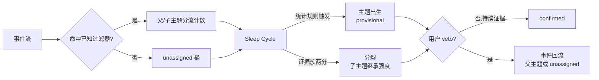

# Astrocyte v0.2 任务书（发现与分裂机制 · Discovery & Split）

来源：用户2026-10-13任务书。状态：冻结期评审稿，未定稿、未开始D0。实码核对与待裁决项见 [评审](v0.2-discovery-split-review.md)。本文件不修改V4锁定协议、不解除验证期冻结令。

## 0. 北极星延伸

v0.1 证明：系统能追踪你告诉它的东西（种子 + 仓根 + 手工播种）。V1R 三线锚点全部吻合，项目级焦点迁移被完整重建。

v0.2 证明：系统能看见你没说的东西。从项目级主题的证据簇中长出子主题，从 unassigned 桶中长出新主题。

一句话：从“记录我”，到“发现我没看见的我”。

触发条件：V4 末次 D+3 对账完成（10-23），验证期冻结令解除当日开工。本文档在冻结期内完成评审定稿，解冻后零讨论直接执行。

## 1. v0.1 交付的三个预注册缺口（v0.2 验收锚点来源）

| 缺口 | 成因（已诊断） | v0.2 解药 |
|---|---|---|
| Agent Swarm 零信号 | 仓根规则把 swarm 子主题折叠进 Morphogenesis | 分裂机制 |
| Agent Memory 零信号 | 论文阅读发生在聊天渠道，三源不覆盖 | 采集源扩展（§7） |
| MCP 零信号 | 关键词附加只标签不写信号 | 分流机制统一解决（§4.4） |

外加：849 unassigned 是发现机制的现成测试集；A(t) 饱和（agent 洪流与人类操作同权）是信号分层的动因（§6）。

## 2. 机制总览



两条出生入口，同一机制：自动（统计规则从证据提取候选）与手工（SeedTopic 扩展为过滤器播种——用户可以说“帮我盯着 X”）。

## 3. 数据契约扩展

### 3.1 Event 增量字段

```text
Event {
  ...v0.1 字段不变...
  origin: first_party | agent_origin
}
```

### 3.2 EvidenceFilter（新对象）

```text
EvidenceFilter {
  id: string
  parent_topic: string
  path_prefixes: []string
  keywords: []string
  min_evidence: int
  source: auto | manual
  rule_version: string
}
```

parent_topic 挂靠父主题，根主题可空；path_prefixes 按 scope 前缀匹配；keywords 按 commit message / 语义标签匹配；min_evidence 默认15；source 区分统计提取与 SeedTopic 播种；rule_version 记录生成过滤器的规则版本。

### 3.3 AttentionNode 增量字段

```text
AttentionNode {
  ...v0.1 字段不变...
  status: provisional | confirmed | vetoed
  born_from: split | discovery | seed
  filter_id: string
}
```

历史 AttentionNode 默认 confirmed、born_from=seed。

## 4. 分裂机制规格

### 4.1 触发（确定性统计，无 embedding）

Sleep Cycle 中对每个 confirmed 主题计算路径前缀分布：

```text
prefix_share(p) = 该前缀下事件数 / 父主题事件总数
触发条件：存在前缀 p 使 prefix_share(p) ≥ 0.15
         且该前缀下事件数 ≥ 15
         且该前缀未对应已存在主题
```

关键词频率同理（commit message 分词，中文按词典，英文按分隔）。阈值与 share 为初始值，10-23 后实验数据可校准一次，之后冻结。

### 4.2 出生（继承，不从零开始）

```text
A_child(出生) = A_parent(t) × prefix_share(p)
M_child(出生) = M_parent(t) × prefix_share(p)
confidence_child = 0.5
related: child → parent 关联强度 = prefix_share(p)
```

子主题不是新事物，是本来就在父主题里被折叠的部分。Agent Swarm 分裂出生时应继承其在 Morphogenesis 内的相对强度。

### 4.3 历史不改写

分裂点之前父主题 A(t) 轨迹逐点不变。分裂点之后满足过滤器的事件计入子主题，父主题保留其余。回放同一事件流必然得到同一分裂点、同一继承值。

### 4.4 分流与统一解决 MCP 缺口

满足子主题过滤器的事件分流（单次计数，不双计），父主题事件数守恒减少。v0.1 的关键词附加（39 条 MCP commit）升级为过滤器分流：标签机制并入计数机制，MCP 缺口与 Agent Swarm 缺口由同一条规则解决。

### 4.5 合并（v1.1 §5.4 既有条款激活）

两主题关联强度持续 > 0.8 且证据重叠 → 合并，历史 attention 取最大。merge 走既有 ObserveAssociationInTx 路径，本任务书只激活调用条件，不改实现。

## 5. unassigned 发现机制规格（EX-01 缺失的候选 provider）

### 5.1 候选生成

Sleep Cycle 对 unassigned 桶执行与 §4.1 相同的统计规则：

```text
unassigned 桶内某路径前缀/关键词聚簇 ≥ 15 条事件
→ 生成 EvidenceFilter（source=auto）
→ 主题候选出生，status=provisional，A 从 A_floor + 冷启动 momentum 起步
```

无父主题可继承。候选生成完全确定性：同输入同输出。LLM 仅对出生后的主题做一句话解释（Interpreter 既有能力，提交后解释），不参与出生决定。

### 5.2 三态生命周期

```text
provisional：出生即参与 attention 计算与焦点排序，UI/接口输出带状态标注
confirmed：连续 3 个 Sleep 日有新证据流入，或用户确认
vetoed：用户 veto → 事件回流 unassigned（discovery）或父主题（split），节点冷存档
```

出生不等批准。人工只有否决权，无批准前置。veto 走既有 astrocyte.veto 通道。

### 5.3 反预填纪律

验收是过程性的：候选生成率、证据链完整性、规则版本可追溯。禁止预填“应该发现什么主题”作为验收条件。849 存量 unassigned 的重处理结果按真实产物记录。

## 6. agent-origin 信号分层

### 6.1 判定规则（确定性）

```text
git commit：author/committer 身份为已知 agent 身份（Codex/Claude/Orca 注册名）
            → agent_origin，否则 first_party
native 事件：source=codex 且会话无人类输入回合 → agent_origin
manual/mcp：first_party
```

### 6.2 权重绑定

```text
w_effective = w × factor(origin)
factor(first_party) = 1.0
factor(agent_origin) = 0.3
```

Astrocyte 仓1006 commits 的饱和主因是 agent 洪流与人类操作同权。0.3 为初始值，10-23 实验数据落地后可校准一次（原因维度暴露机器行为淹没人类信号则调低，反之调高），校准后冻结至 v0.3。STATUS 记录改前值、改后值、依据样本。

## 7. 采集源扩展（Agent Memory 缺口）

新增确定性映射：会话事件消息载荷含 arxiv.org/ACL/论文 DOI URL → kind=read_paper 信号，topic 按既有仓根/种子规则。

实现位置在接入层 URL 提取（raw → derived 化），不改隐私边界：URL 属 derived 投影白名单扩展，MCP exposure 增补该字段审计。论文阅读信号 w=1.0（隐式深度，v1.1 权重表既有条目）。

## 8. 确定性与可复算

- 全部触发/出生/分流规则确定性，LLM 零决策。
- 规则版本化：修改规则须全量重跑，禁止按结果微调。
- M2 验收扩展：V1R2855事件重跑，分裂点、继承值、分流后父主题轨迹逐点复算，误差0。
- 首个 RED 保留纪律延续。

## 9. 里程碑

| 阶段 | 交付 | 验收 |
|---|---|---|
| D0 | §3 全部 schema + 过滤器规则引擎接口 | schema 测试；v0.1 事件可无损携带 origin |
| D1 | 触发/出生/继承/分流 | 合成两簇分裂；继承值手工复算一致 |
| D2 | unassigned 候选 provider + 三态生命周期 | 849存量重处理；候选带规则版本和证据链 |
| D3 | origin 分层 + 采集扩展 | origin抽检50；arxiv URL实测 |
| D4 | V1R 回放回归 | 分裂点确定性误差0；父主题分裂前轨迹不变 |
| D5 | 定向验收 | Agent Swarm 从 Morphogenesis 显影：A>0、证据回溯 swarm 路径、继承复算一致 |
| D6 | M2 扩展 + 集成 | 全量确定性回放；STATUS登记 |

D5 是北极星验收：Agent Swarm 在 v0.2 分裂机制下从887个 Morphogenesis commit 的证据簇中自己长出来。通过后形成第一个可演示实例。

## 10. 红线

- 不引入 embedding/向量相似度；sqlite-vec 不复活。
- 出生无人工批准前置，provisional 即参与计算。
- 分裂不改写历史。
- 禁止预填发现结果作为验收。
- A(t)/M(t)/衰减结构零改；只动出生链调用条件、过滤器、分流计数、origin字段权重因子。
- 权重表校准仅一次（10-23后），依据入档。

## 11. 文风纪律

句子只用于推进实现或传递信息；删除“为了稳妥起见”“这在某些情况下可能会有问题”“仅供参考”及不改变下一步动作的免责声明。
