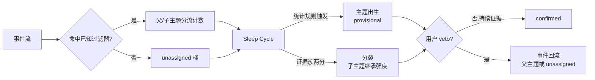

# Astrocyte v0.2 任务书 v1.1（发现与分裂机制 · Discovery & Split）

来源：用户2026-10-13任务书及R01–R12规格裁决；裁决基线 `21796418241a65e230914207f18b995bfa31713d`。状态：SPEC_FINALIZED_IMPLEMENTATION_FROZEN，未开始D0。本版取代原评审稿冲突条款；[评审结论](v0.2-discovery-split-review.md)及[精确写域计划](v0.2-discovery-split-plan.md)同步更新。不修改V4锁定协议、不解除验证期冻结令。

## 0. 北极星延伸

v0.1 证明：系统能追踪你告诉它的东西（种子 + 仓根 + 手工播种）。V1R 三线锚点全部吻合，项目级焦点迁移被完整重建。

v0.2 证明：系统能看见你没说的东西。从项目级主题的证据簇中长出子主题，从 unassigned 桶中长出新主题。

一句话：从“记录我”，到“发现我没看见的我”。

触发条件：V4末次D+3实际完成 + 验证期冻结令解除，当日开工。10-23是排程日期，不是完成证据；V4人评或对账缺失则不启动。冻结期内只定稿文档；解冻后按本规格执行，不重开已裁决项。v0.2 D0–D6是开发里程碑，与V4 day0–day6分开记录。

## 1. v0.1 交付的三个预注册缺口（v0.2 验收锚点来源）

| 缺口 | 成因（已诊断） | v0.2 解药 |
|---|---|---|
| Agent Swarm 零信号 | 仓根规则把 swarm 子主题折叠进 Morphogenesis | 分裂机制 |
| Agent Memory 零信号 | 论文阅读发生在聊天渠道，三源不覆盖 | 采集源扩展（§7） |
| MCP 零信号 | 关键词附加只标签不写信号 | 分流机制统一解决（§4.4） |

外加：849 unassigned 是发现机制的现成测试集；A(t) 饱和（agent 洪流与人类操作同权）是信号分层的动因（§6）。

## 2. 机制总览



两条出生入口，同一机制：自动（统计规则从证据提取候选）与手工（SeedTopic 扩展为过滤器播种——用户可以说“帮我盯着 X”）。

## 3. 数据契约扩展

### 3.1 Event 增量字段

```text
Event {
  ...v0.1 字段不变...
  origin: first_party | agent_origin
}
```

### 3.2 EvidenceFilter（新对象）

```text
EvidenceFilter {
  id: string
  parent_topic: string
  path_prefixes: []string
  keywords: []string
  min_evidence: int
  source: auto | manual
  rule_version: string
}
```

parent_topic挂靠父主题，根主题可空；path_prefixes匹配独立仓内变更路径维度，scope仍只表示项目归属；keywords匹配版本化词典token；min_evidence默认15；source区分统计提取与SeedTopic播种；rule_version记录生成规则。词典与别名表绑定token→显示名（如swarm→Agent Swarm），候选命名不由LLM决定。

### 3.2.1 最小本地 derived 特征（R02）

授权范围限定五项，不进MCP Event exposure，六字段 `{event_id, kind, topic, tokens, scope, ts}` 不变，不重开隐私审计面：

| 特征 | 来源与边界 |
|---|---|
| 仓内相对变更路径 | 按冻结commit ID执行 `git diff-tree --name-only -r`；禁止从当前工作树猜历史 |
| author身份匹配结果 | 命中agent身份表返回表项名，否则first_party；原始name/email仅本机 |
| 事件时点人类回合布尔 | 按会话结构逐事件判定，不读取未来回合改写过去 |
| 规范URL集合 | 白名单域、host小写、去query/fragment；不保留正文或凭据字符串 |
| 关键词词典与别名表 | 版本化内容、token→显示名；规则变更全量重跑 |

上述特征是本地derived，origin为Event新增本地字段；不会直接序列化Event或将本地特征透传到MCP。主题状态标注属于主题响应，不改变Event六字段投影。

### 3.3 AttentionNode 增量字段

```text
AttentionNode {
  ...v0.1 字段不变...
  status: provisional | confirmed | vetoed
  born_from: split | discovery | seed
  filter_id: string
}
```

历史 AttentionNode 默认 confirmed、born_from=seed。

收养的零证据种子ID不变，born_from更新为split，seed出身记入lineage，status维持confirmed；已有证据或已有filter的节点不覆盖。lineage与原始继承值记入既有transition历史扩展，供本地复算与解释读取，不新增证明系统。

## 4. 分裂机制规格

### 4.1 触发（确定性统计，无 embedding）

每个Sleep时点，对confirmed主题全生命周期累计证据按唯一event_id计算路径前缀分布；unassigned统计同样取全生命周期累计桶。仓根前缀排除，避免主题自身100%命中。

```text
prefix_share(p) = 该前缀下事件数 / 父主题事件总数
触发条件：存在前缀 p 使 prefix_share(p) ≥ 0.15
         且该前缀下事件数 ≥ 15
         且目标主题不存在，或满足零证据种子收养条件
```

多层前缀取满足阈值的最深者，每事件只归一个最具体匹配。路径优先于关键词；关键词并列按频次降序、字典序决胜。频次按唯一event_id计数，不按同一事件中词重复次数计数。中文按版本化词典，英文按分隔，显示名按别名表；词典不按D5成功结果反定。阈值/share为初值，V4数据实际落地后可校准一次，之后冻结。

### 4.1.1 零证据种子收养（R01）

收养时点节点挂靠证据数必须为0且无filter。保留ID，记录seed lineage，born_from=split，status保持confirmed，不走三日窗。已有证据或已有filter的节点永不覆盖；禁止新建同名主题。D5中Agent Swarm以收养方式显影。

### 4.2 出生（继承，不从零开始）

```text
inherited_A = A_parent(Sleep事务开始) × prefix_share(p)
A_child(出生) = max(A_floor, inherited_A)
M_child(出生) = M_parent(t) × prefix_share(p)
confidence_child = 0.5
related: child → parent 关联强度 = prefix_share(p)
```

子主题不是新事物，是本来就在父主题里被折叠的部分。Agent Swarm 分裂出生时应继承其在 Morphogenesis 内的相对强度。

R05：transition分别记录原始inherited_A与实际A_child；M使用同一事务开始快照按share继承，不设floor下限。confidence=.5，关联strength=share，不写1。

### 4.2.1 FilterSplit 新事务（R04）

不激活旧SplitTopic，其定义与历史保持，旧生产调用为0。新FilterSplit保持父主题active、不退役；出生动作Applied去重键为 `(filter_id, rule_version, 出生ts)`。继承快照取该Sleep事务开始时的父状态，同Sleep多分裂按主题名字典序→filter id排序，不能用前一个子主题创建后的父状态重取快照。

### 4.3 历史不改写

分裂点之前父主题历史A(t)不改写；分裂后命中过滤器的事件计入子主题，父主题保留其余。固定输入/规则/Sleep时钟得到同一分裂点与继承值。与v0.1数值逐点一致的回归关闭origin折扣；启用origin因子的v0.2回放对比独立v0.2参考，见§8。

### 4.4 分流与统一解决 MCP 缺口

满足子主题过滤器的事件分流（单次计数，不双计），父主题事件数守恒减少。v0.1 的关键词附加（39 条 MCP commit）升级为过滤器分流：标签机制并入计数机制，MCP 缺口与 Agent Swarm 缺口由同一条规则解决。

### 4.5 合并（v1.1 §5.4 既有条款激活）

两主题关联强度>0.8、证据真实重叠、连续3个Sleep观测满足条件才合并，历史attention取最大。每Sleep仅观测一次；父子继承边排除出merge候选，不能用继承共享证据形成平凡合并。只复用ObserveAssociationInTx既有实现，不改实现、不虚构交叠或强度。

R09实码单位绑定：MergeObservations=3。每日观测的第一次至第三次跨度 `(3-1)×86400000=172800000ms`，绑定MergeDurationMS=172800000；不是3毫秒，也不把3次观测误算为需4次的3天跨度。Sleep调用侧负责连续日资格，漏日/不满足资格归零；原ObserveMerge不会仅因时间缺口自动归零。验收要求第三次连续合格观测触发，前两次、漏日或同ts重放不触发，merge函数本身不变。

## 5. unassigned 发现机制规格（EX-01 缺失的候选 provider）

### 5.1 候选生成

Sleep Cycle 对 unassigned 桶执行与 §4.1 相同的统计规则：

```text
unassigned 桶内某路径前缀/关键词聚簇 ≥ 15 条事件
→ 生成 EvidenceFilter（source=auto）
→ 主题候选出生，status=provisional
出生ts = 触发Sleep ts
A₀ = A_floor = 0.05
M₀ = 0.15
last_active = 出生ts
```

无父主题可继承，不回填首条历史ts。创始簇只挂靠证据与Applied标记，零回溯信号；仅出生ts之后的事件贡献信号。跨scope关键词簇聚合为单一主题，注意力图是个人级；路径簇天然按仓归属。候选生成完全确定性；Interpreter只提交后解释，不参与出生决定。

### 5.2 三态生命周期

```text
provisional：出生即参与 attention 计算与焦点排序，UI/接口输出带状态标注
confirmed：出生Sleep为day0；后续连续3个Sleep日每天≥1条新证据，或用户确认
vetoed：既有-.8 veto事件 + status=vetoed + filter/rule_version抑制，节点冷存档
```

出生无批准前置；零证据种子收养保持confirmed。普通provisional出生日不计确认窗，day1–3每天须≥1条新证据，任一空日计数归零，第三个连续日confirmed。

veto沿既有astrocyte.veto通道补生命周期动作：回流只改变未来路由，discovery→unassigned、split→父主题；不补偿当前强度，历史signal/轨迹不动，Applied不重复。同filter_id+rule_version永久抑制，新rule_version可重新提名；用户重新启用须显式SeedTopic过滤器重播。

### 5.3 反预填纪律

验收是过程性的：候选生成率、证据链完整性、规则版本可追溯。禁止预填“应该发现什么主题”作为验收条件。849 存量 unassigned 的重处理结果按真实产物记录。

## 6. agent-origin 信号分层

### 6.1 判定规则（确定性）

```text
git事实优先：author命中版本化agent身份表 → agent_origin，否则first_party
            author人类而committer agent → first_party
native：Codex/Claude Code同规则，事件ts前同会话有实际人类输入回合
        → first_party，否则agent_origin；未来回合不重标过去
其他manual/mcp：first_party
```

committer不单独参与判定。身份表从冻结commit ID实际author字段构建，版本化、本机，不从产品登记名推定；原始name/email不外露。git匹配覆盖其manual源类别默认值。旧事件不迁移重标，v0.2起增量适用；历史回放只在独立v0.2库派生特征，不修改v0.1原件。

### 6.2 权重绑定

```text
w_effective = w × factor(origin)
factor(first_party) = 1.0
factor(agent_origin) = 0.3
```

Astrocyte 仓1006 commits 的饱和主因是 agent 洪流与人类操作同权。0.3 为初始值，10-23 实验数据落地后可校准一次（原因维度暴露机器行为淹没人类信号则调低，反之调高），校准后冻结至 v0.3。STATUS 记录改前值、改后值、依据样本。

## 7. 采集源扩展（Agent Memory 缺口）

新增确定性映射：消息含白名单论文URL→kind=read_paper，topic沿既有仓根/种子规则，不按paper kind自动指派Agent Memory。

白名单域 `{arxiv.org, aclanthology.org, doi.org, dl.acm.org}`，host小写、去query/fragment后匹配。按消息ID去重：一条消息一个read_paper，多URL留同事件payload，不按论文数计事件。工具调用与消息同URL+同会话+同日→单事件。禁止正文/凭据字符串升格derived，只保留规范URL本身。

提取在接入层raw→本地derived；URL不进入MCP exposure，Event六字段保持，取代原稿“新增URL exposure”条款。read_paper基础w=1.0，实际贡献再按§6 origin因子绑定。新增论文URL人口单报，不混入2855原件分母。

## 8. 确定性与可复算

- 全部触发/出生/分流规则确定性，LLM 零决策。
- 规则版本化：修改规则须全量重跑，禁止按结果微调。
- M2扩展：固定V1R2855原件、同ts次序与30个生产Sleep，分裂点、原始/实际继承、唯一分流、父轨迹逐点复算，误差0。
- D4双轨：轨道一origin因子=1隔离分裂，分裂前与v0.1逐点一致；轨道二启用origin因子完整回放，对比独立v0.2参考。均用新目录独立库，不覆盖2855原件或v0.1轨迹。
- 原V1R只读不迁移；补采路径/author依据固定原commit ID，独立派生记录按event_id可追溯，不把补采结果伪称原件已有字段。
- 首个 RED 保留纪律延续。

## 9. 里程碑

| 阶段 | 交付 | 验收 |
|---|---|---|
| D0 | §3 全部 schema + 过滤器规则引擎接口 | schema 测试；v0.1 事件可无损携带 origin |
| D1 | 触发/出生/继承/分流 | 合成两簇分裂；继承值手工复算一致 |
| D2 | unassigned 候选 provider + 三态生命周期 | 849存量重处理；候选带规则版本和证据链 |
| D3 | origin 分层 + 采集扩展 | origin抽检50；arxiv URL实测 |
| D4 | V1R双轨回归 | origin=1时分裂前与v0.1一致；分层回放对独立v0.2参考，各点误差0 |
| D5 | 定向验收 | Agent Swarm以原种子收养显影：ID不变、A>0、真实swarm路径证据、原始/实际继承复算一致 |
| D6 | M2 扩展 + 集成 | 全量确定性回放；STATUS登记 |

D5是北极星验收：Agent Swarm由887个Morphogenesis commit的真实证据簇过滤器收养显影，不手工补证据、不新建同名主题。seed原floor>0不独自构成D5通过，须有实际收养transition、真实路径证据和继承复算。

### 9.1 D0–D6 验收展开（用户整体采纳；裁决冲突处以v1.1为准）

| 阶段 | 必须产生的实际证据 |
|---|---|
| D0 | 默认迁移与原event_id/raw字节不变；版本化过滤器接口、词典/别名/身份表/排序；本地derived五项不进入MCP，Event投影仍精确六字段 |
| D1 | 合成两簇与重叠簇：唯一event_id数守恒、无双信号、父active保留剩余、原始继承/实际A/M逐点复算；重复Sleep不重复出生；seed收养和floor边界回归 |
| D2 | 固定849输入全保留；候选率分子/分母、每filter版本与完整event_id；连续证据/空日/人工确认/veto/永久抑制/新版本与显式重播；零候选按真实结果记录 |
| D3 | 预声明kind-blind50个origin样本、author/事件时点回合依据；既有paper与新增URL按消息及跨工具去重；原六字段及错误路径回归；旧与新增人口分报 |
| D4 | 固定2855、同ts次序与30生产Sleep；两次独立确定性回放同分裂点/继承/路由/每点A/M；双轨分别验收，无墙钟/未来会话污染 |
| D5 | 先固定规则，Swarm按真实路径/关键词匹配收养；ID不变/confirmed/seed lineage；不得手工补出生、硬填簇或迭代阈值；证据可回溯、继承误差0，未达保留RED |
| D6 | 原M2/EX-01历史基线与v0.2适用回归、重启持久化、主题状态响应和Event六字段边界、真实全量确定性产物；独立SOURCE/REPORT、普通集成与最终push |

### 9.2 精确写域与派发

共享契约/migrations/projection归shared owner；接入/路径/身份/URL归events owner；Sleep/过滤器/路由/生命周期/继承归单一机制owner，出生事务禁止双轨共写；M2 owner仅独立参考复算。精确文件及依赖见[计划](v0.2-discovery-split-plan.md)。本轮不派发，不创建业务worktree或实现文件。

## 10. 红线

- 不引入 embedding/向量相似度；sqlite-vec 不复活。
- 出生无人工批准前置，provisional 即参与计算。
- 分裂不改写历史。
- 禁止预填发现结果作为验收。
- A(t)/M(t)/衰减结构零改；旧SplitTopic不激活，merge实现不改；只新增已裁决的FilterSplit事务、过滤器/分流、生命周期、origin及接入契约。
- 本地derived五项不新增到MCP exposure，Event六字段不变。
- 基础七类权重表v0.2不校准，V4数据留v0.3议。

### 10.1 校准分离（R12）

V4数据实际落地、冻结解除后，三个旋钮各最多一次校准：发现阈值15、share .15、origin因子.3；基础七类表零次。每次登记改前值、改后值、固定样本与规则版本并全量重跑。origin校准后冻结至v0.3；禁止用D5结果迭代阈值、禁止按成功结果定词典。保留初值也明确记录“未调整”，不伪填校准依据。

## 11. 文风纪律

句子只用于推进实现或传递信息；删除“为了稳妥起见”“这在某些情况下可能会有问题”“仅供参考”及不改变下一步动作的免责声明。
